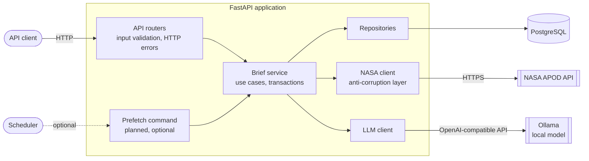
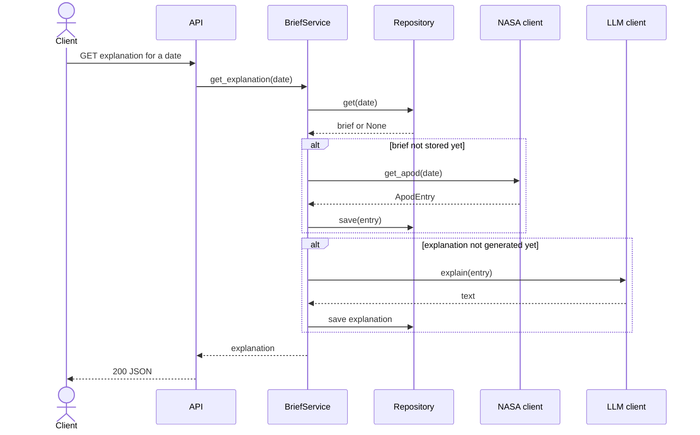

# AI Astronomy Daily Brief


[](https://github.com/OstapchukIryna/astronomy-brief/actions/workflows/ci.yaml)

[](https://codecov.io/gh/OstapchukIryna/astronomy-brief)
[](https://github.com/astral-sh/uv)

Every day NASA publishes an astronomy photo with a short astronomer's explanation, that are great, but often hard to follow if you are not an expert in the topic.

This API takes a day's picture and builds a small brief around it with the original image and text, adds a simpler explanation written by an LLM, can provide you with a few key facts, and a way to ask follow-up questions.

## Features

| Feature | Status |
|---|---|
| Health checks | ✅ done |
| Get a day's APOD with image metadata and the original explanation | 🚧 planned |
| Beginner-friendly explanation | 🚧 planned |
| 3–5 key facts | 🚧 planned |
| Follow-up questions about the topic | 🚧 planned |
| History of past briefs with filters | 🚧 planned |

## Tech stack

FastAPI, async SQLAlchemy with PostgreSQL, Pydantic, httpx, Ollama (or any OpenAI-compatible API), pytest.


## Architecture

The code is split into layers, and each layer only can reach the next one down.



Routers deal only with HTTP and check the users' input.

The service layer contains business-logic. With everything goes through it, the planned prefetch command can reuse it without any changes.

NASA and the LLM are only reachable through their own clients. A client converts data the outside API returns into the app's-needed types.

### Lazy generation

Each part of a brief is generated on first request:



The first time a date is requested, the app fetches it from NASA and stores it.
The LLM explanation and facts are also generated on the first request and saved that makes next request a db-read operation.

The parts don't depend on each other by desing. That means, if Ollama is down, the NASA's original data is still available.

### Setup

```bash
git clone https://github.com/OstapchukIryna/astronomy-brief.git
cd astronomy-brief
cp .env.example .env         # add your NASA key and the model name
docker compose up -d
ollama pull <model>
uv sync
uv run uvicorn app.main:app --reload
```

Then open http://localhost:8000/docs.

## API

| Method | Path | Description |
|---|---|---|
| `GET` | `/health` | Liveness: the process is up |
| `GET` | `/health/ready` | Readiness: the database is reachable (or `503`) |


## Project structure

```
app/
├── api/routers/     # HTTP layer: request/response, status codes
├── services/        # use cases and transaction boundaries
├── repositories/    # database access
├── clients/         # external APIs (NASA, LLM providers)
├── models/          # SQLAlchemy models
├── schemas/         # Pydantic request/response schemas
├── prompts/         # LLM prompt templates
├── config.py        # settings from environment
├── database.py      # engine, sessions, DB dependency
└── main.py          # app factory and lifespan
tests/               # mirrors app/ structure
```
