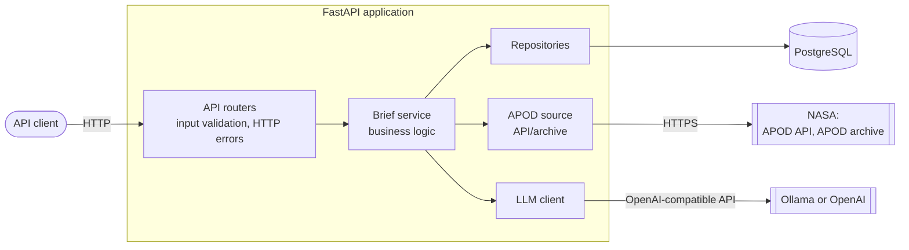
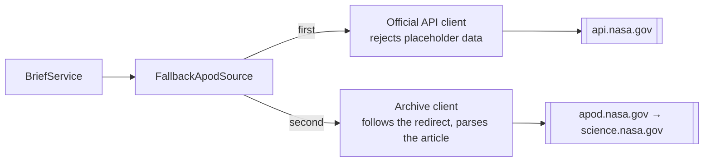
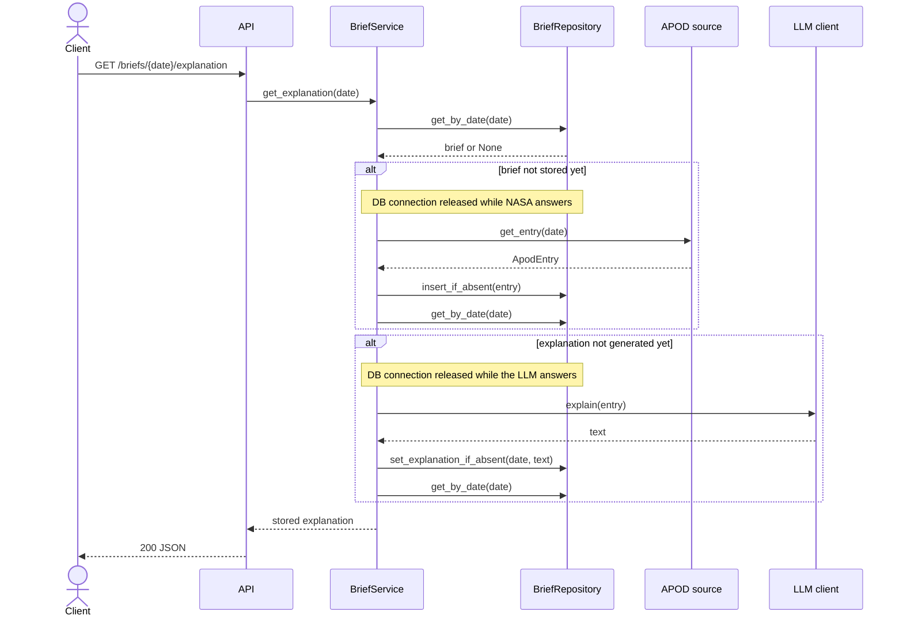

# AI Astronomy Daily Brief


[](https://github.com/OstapchukIryna/astronomy-brief/actions/workflows/ci.yaml)
[](https://codecov.io/gh/OstapchukIryna/astronomy-brief)

[](https://github.com/astral-sh/uv)

Every day NASA publishes an astronomy photo with a short explanation by an astronomer. The explanations are great, but often hard to follow if you are not an expert in the topic.

This API takes a day's picture and builds a small brief around it. It takes the original image and text, provide a simpler explanation written by an LLM, a few key facts, and a way to ask follow-up questions.

## Features

| Feature | Status |
|---|---|
| Health checks | ✅ done |
| Get a day's APOD with image metadata and the original explanation | ✅ done |
| Beginner-friendly explanation | ✅ done |
| 3–5 key facts | ✅ done |
| Follow-up questions about the topic | 🚧 planned |
| History of past briefs with filters | ✅ done |

## Tech stack

FastAPI, async SQLAlchemy with PostgreSQL, Pydantic, httpx, Ollama (or any OpenAI-compatible API), pytest.


## Architecture

The code is split into separate layers.



Routers deal only with HTTP and check the user's input.
The service layer contains the business logic.
NASA and the LLM each have their own client. Each client converts what the outside API returns into the app's own types.

### Archive decision

NASA's official APOD API currently returns placeholder data for every date, so the app uses two sources:




### Lazy generation

Each part of a brief is generated lazily:



The first time a date is requested, the app fetches it from NASA and stores it.
The LLM explanation and facts are also generated on the first request and saved, so the next request only reads from the database.

The parts don't depend on each other by design. That means, if Ollama is down, NASA's original data is still available. Also new saves never overwrite existing data. With that said, if two requests generate an explanation at the same time, the first one saved, and both will return it.

### Setup

```bash
git clone https://github.com/OstapchukIryna/astronomy-brief.git
cd astronomy-brief
cp .env.example .env         # add your NASA key and the model name
docker compose up -d
ollama pull qwen2.5:7b
uv sync
uv run alembic upgrade head
uv run uvicorn app.main:app --reload
```

Then open http://localhost:8000/docs.

## API

| Method | Path | Description |
|---|---|---|
| `GET` | `/health` | The app is running |
| `GET` | `/health/ready` | The database is reachable |
| `GET` | `/briefs` | Lists stored briefs, filtered by dates and a title keyword |
| `GET` | `/briefs/{date}` | Returns the APOD for a date (`YYYY-MM-DD`) |
| `GET` | `/briefs/{date}/explanation` | Returns a beginner-friendly explanation |
| `GET` | `/briefs/{date}/facts` | Returns 3–5 key facts |

```bash
curl http://localhost:8000/briefs/2020-01-01
curl http://localhost:8000/briefs/2020-01-01/explanation
curl http://localhost:8000/briefs/2020-01-01/facts
curl "http://localhost:8000/briefs?date_from=2020-01-01&date_to=2020-01-31"
curl "http://localhost:8000/briefs?keyword=betelgeus"
```


## Project structure

```
app/
├── api/routers/     # HTTP with request/response, status codes
├── services/        # the actual logic and transactions
├── repositories/    # database queries
├── clients/         # NASA and LLM clients
├── domain/          # core types, errors and interfaces
├── models/          # SQLAlchemy models
├── schemas/         # Pydantic request/response schemas
├── prompts/         # prompt templates for LLM
├── config.py        # settings from environment
├── database.py      # engine, sessions, DB dependency
└── main.py          # app setup
tests/               # same layout as app/
```
