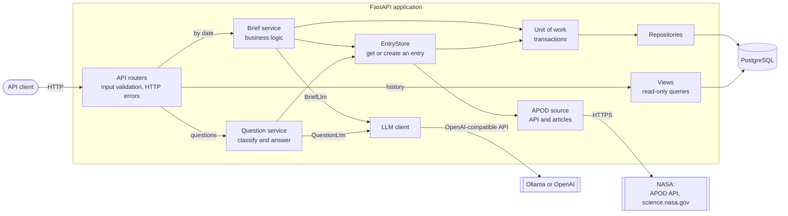
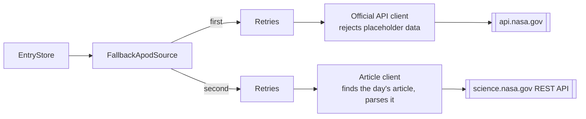
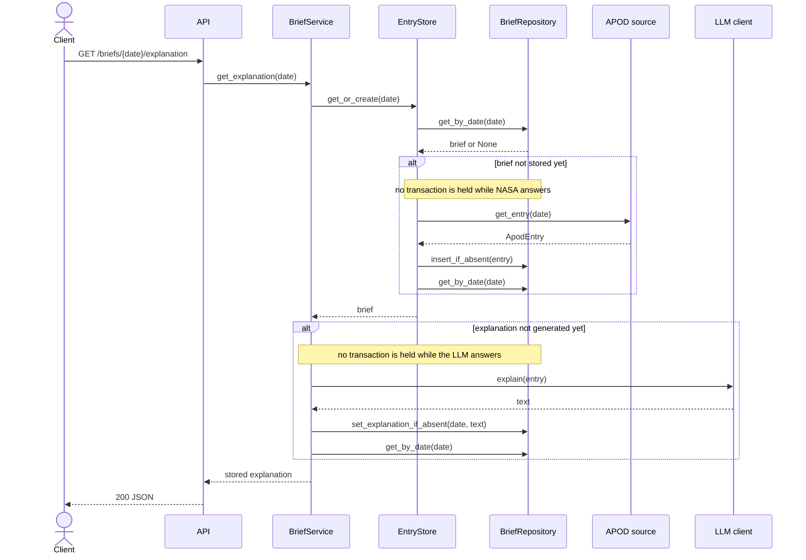

# AI Astronomy Daily Brief


[](https://github.com/OstapchukIryna/astronomy-brief/actions/workflows/ci.yaml)
[](https://codecov.io/gh/OstapchukIryna/astronomy-brief)

[](https://github.com/astral-sh/uv)

Every day NASA publishes an astronomy photo with a short explanation by an astronomer. The explanations are great, but often hard to follow if you are not an expert in the topic.

This API takes a day's picture and builds a small brief around it. It takes the original image and text, provides a simpler explanation written by an LLM, a few key facts, and a way to ask follow-up questions.

## Tech stack

FastAPI, async SQLAlchemy with PostgreSQL, Pydantic, Ollama (or any OpenAI-compatible API), pytest.


## Features

| Method | Path | Returns |
|---|---|---|
| `GET` | `/briefs/{date}` | The picture for a date from 1995-06-16 to today (US Eastern time): title, image or video URL, credit and NASA's explanation |
| `GET` | `/briefs/{date}/explanation` | NASA's text rewritten for readers without a science background, using only what the text says |
| `GET` | `/briefs/{date}/facts` | 3 to 5 short facts about the topic |
| `POST` | `/questions` | An answer of up to 3 sentences to a question about the day's picture |
| `GET` | `/briefs` | Stored briefs, newest first, filtered by dates and a title keyword that tolerates typos |
| `GET` | `/health` | The app is running |
| `GET` | `/health/ready` | The app is running and the database answers |

## Setup

```bash
git clone https://github.com/OstapchukIryna/astronomy-brief.git
cd astronomy-brief
cp .env.example .env         # add your NASA key
docker compose up -d
ollama pull qwen2.5:7b
uv sync
uv run alembic upgrade head
uv run uvicorn app.main:create_app --factory --reload
```

Then open http://localhost:8000/docs.

## Examples

```bash
curl http://localhost:8000/briefs/2026-10-10
curl http://localhost:8000/briefs/2026-10-10/explanation
curl http://localhost:8000/briefs/2026-10-10/facts
curl "http://localhost:8000/briefs?date_from=2020-01-01&date_to=2020-01-31"
curl "http://localhost:8000/briefs?keyword=betelgeus"   # finds "Betelgeuse"
```
### Questions

```bash
curl -X POST http://localhost:8000/questions \
  -H "Content-Type: application/json" \
  -d '{"date": "2020-01-01", "question": "Why is Betelgeuse fading?"}'
```

Rules about question and answer:
- Questions are accepted in English only. A question in another language is refused with the off-topic message.
- A question is 3 to 300 characters long after trimming. Tabs and line breaks are allowed inside of the message, but other control characters are not.
- It must be about the day's picture. If not, a classifier marks it as an off-topic question and returns a 400.
- Answers use NASA's text first and general knowledge where the text isn't enough.
- The model is asked for up to 3 sentences in English.
- Answers are not stored.

## Architecture

The code is split into separate layers.
Routers deal only with HTTP and check the input types, while rules for the input are checked in the domain layer.
The service layer contains the business logic.
NASA and the LLM each have their own client. Each client converts what the outside API returns into the app's own types.



### Two NASA sources

NASA's official APOD API returns placeholder data for many recent dates. This app uses two sources:



### Generated once, lazily

The explanation and the facts are generated on their first request and stored in the database. During processing, no transaction stays open while NASA or the model answers.



### Design decisions

The first time a date is requested, the app fetches it from NASA and stores it.

The LLM explanation and facts are also generated on the first request and saved, so the next request only reads from the database.

The parts don't depend on each other by design. That means, if Ollama is down, NASA's original data is still available. Also new saves never overwrite existing data. With that said, if two requests generate an explanation at the same time, the first one is saved, and both will return it.

Model calls are not retried intentionally, and NASA calls are retried with Tenacity.

The question classifier only filters out questions unrelated to astronomy. Asked whether a question was “on topic”, the local model refused questions built on a wrong assumption; now those get an answer that corrects them, at the cost of answering some borderline questions.

## Tests

```bash
docker compose exec db createdb -U astro astronomy_test
uv run pytest
```
Mutation testing runs on the small tests without database:

```bash
uv run mutmut run                  # every module in app/
uv run mutmut run "app.domain.*"
uv run mutmut results
uv run mutmut show <mutant>        # the change of one mutant
uv run mutmut browse               # browse and rerun mutants
```

## Project structure

```
app/
├── api/
│   ├── routers/          # HTTP with requests, responses, status codes
│   ├── errors.py         # shared table of errors, statuses and messages
│   └── dependencies.py   # wiring dependencies into routers
├── services/             # use cases and transaction boundaries
├── domain/               # value objects, rules, protocols, errors
├── repositories/         # database write operations and the unit of work
├── views.py              # read-only queries for the history
├── clients/              # NASA and model clients
├── models/               # SQLAlchemy models
├── schemas/              # Pydantic request and response models
├── prompts/              # prompts for the model
├── bootstrap.py          # builds the long-lived dependencies
├── config.py             # settings from the environment
├── database.py           # engine and session factory
└── main.py               # app factory
migrations/               # Alembic migrations
```
